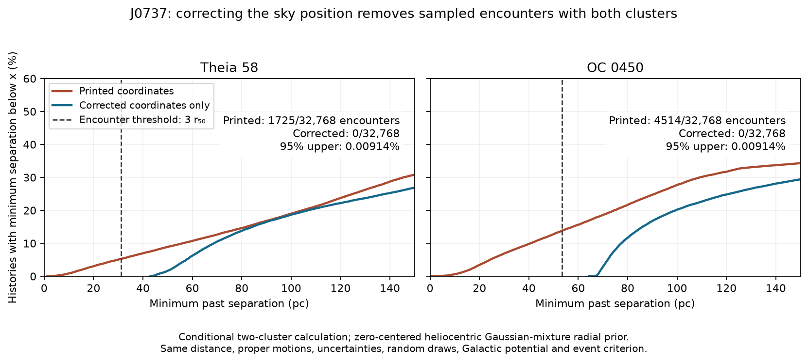

# J0737−3039: wrong coordinates in Yu et al. (2026)

**[Yu et al. (2026)](https://doi.org/10.3847/2041-8213/ae4bd1) give the wrong sky position for the double pulsar J0737−3039. They list a right ascension of 144.448°; the measured value is 114.4635°. Their coordinates put the pulsar 25.719° away from its measured position. It is quite shocking that this error has passed peer-review in the Astrophysical Journal Letters**

**Correcting only this position in our reconstruction removes the close past passes to Theia 58 and OC 0450 in the main simulations.** Those passes support the paper's proposed birthplace links. These links therefore need reassessment.

This repository contains the evidence, code, and saved results.

## The coordinate error

| Sky coordinate | Yu et al., Table 1 | Measured by Kramer et al. (2021) |
|---|---:|---:|
| Right ascension | 144.448° | 114.4635338125° |
| Declination | −30.6278° | −30.6613069028° |

**Why 114.4635° is correct:** [Kramer et al. (2021), Table IV](https://arxiv.org/pdf/2112.06795#page=20) report **07h 37m 51.248115s**, measured from the arrival times of radio pulses. Right ascension uses 24 hours for a full 360° circle, so each hour equals 15°:

```text
15 × (7 + 37/60 + 51.248115/3600) = 114.4635338125°
```

The wrong values appear in both the [manuscript table](sources/yu2026_table1_J0737.tex) and the [publisher's data table](sources/yu2026_table1_J0737.tsv). The measured position is at epoch MJD 55045. Adjusting for the pulsar's motion to 2016 changes its position by only **0.021 arcseconds**—far too little to explain the error.

## Correcting the position changes the result

We traced **32,768 possible past paths** twice, changing only the pulsar's sky position. All other inputs and random draws stayed the same.

| Cluster | Paper: fraction passing close | Our run: paper's position | Our run: corrected position |
|---|---:|---:|---:|
| Theia 58 | 5.35% | **5.26%** (1,725 / 32,768) | **0 / 32,768** |
| OC 0450 | 13.87% | **13.78%** (4,514 / 32,768) | **0 / 32,768** |

These are fractions of simulated paths meeting the encounter criterion, not probabilities of a birthplace. This run uses a Gaussian-mixture assumption for the unknown radial velocity. A uniform-velocity test also gives **0 / 32,768** corrected-position encounters for each cluster.



## The published figure also points to the wrong position

We extracted the path from the paper's [Figure 2 PDF](audit/sources/j0737_oc_orbits.pdf) and fitted an orbital model to it. Under the tested model, frame, and timing interpretation, the path implies right ascension **144.526°**, close to the wrong value. Allowing its time placement to vary over 0–24 million years still leaves the inferred position at least **24.252°** from the measured position.

This is evidence that the error reached the plotted calculation. [Checks using artificial paths with known inputs](audit/results/inversion_controls.json) support the fitting method. It does not establish the exact inputs to every original run.

## Limits of the finding

- **Zero sampled encounters does not mean impossible.** A test with broader cluster-motion uncertainties produced one corrected-position OC 0450 encounter in 4,096 paths.
- **We have not recovered the authors' original calculation files.** The cause of the coordinate error remains unknown. Our reconstruction is approximate; figure mismatches and unsuccessful checks are retained in [methods and limitations](docs/METHODS_AND_LIMITATIONS.md).
- **The conclusion concerns these two birthplace links.** It does not identify the actual birthplace or establish consequences for other systems or general formation theories.

## Reproduce the checks

Check the coordinate error with Python alone:

```bash
python3 scripts/check_coordinates.py
```

Verify the saved evidence and rerun a smaller simulation plus the figure checks (Python 3.12):

```bash
python3 -m venv .venv
.venv/bin/python -m pip install -r requirements.txt
.venv/bin/python scripts/verify.py
.venv/bin/python scripts/reproduce.py --quick
```

Use `--full` instead of `--quick` to repeat the full archived experiment. See the [reproduction guide](docs/REPRODUCING.md).

[Evidence guide](docs/EVIDENCE.md) · [Saved simulations](trajectory/results/) · [File checksums](SHA256SUMS) · [File provenance](provenance/EXPORT.json) · [Attribution and licensing](THIRD_PARTY_NOTICES.md)

Independent, AI-assisted audit dated 19 October 2026, examining [arXiv:2602.14145v1](https://arxiv.org/abs/2602.14145v1). This is not an author-issued correction.
